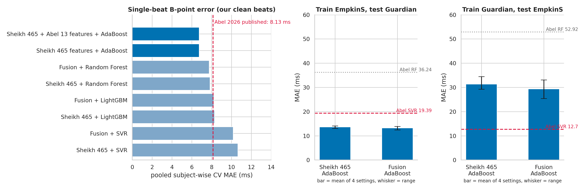

# ICG B-Point Fusion

**Detecting the aortic-valve-opening (B) point in the impedance cardiogram: applying Sheikh et al.'s 465-feature method to the public beat-to-beat datasets of Abel et al.**

 -green) 

> Live results (login required): **https://renofusion.me/ICG-BPoint-Fusion/** · Login details are shared privately with the research team.

---

## Contents
1. [Why this project](#1-why-this-project)
2. [The two papers](#2-the-two-papers)
3. [Data](#3-data)
4. [What has been built](#4-what-has-been-built)
5. [Repository layout](#5-repository-layout)
6. [Pipeline steps](#6-pipeline-steps)
7. [Key findings so far](#7-key-findings-so-far)
8. [The website and its login](#8-the-website-and-its-login)
9. [Reproduce](#9-reproduce)
10. [Limitations](#10-limitations)
11. [References](#11-references)

---

## 1. Why this project
The **B point** of the impedance cardiogram (ICG) marks the opening of the aortic valve. Together with the ECG Q-wave it gives the **pre-ejection period (PEP)**, a marker of sympathetic activity and heart function. The B point is small and its shape varies, so it is hard to detect automatically, especially **beat by beat**.

Two recent lines of work attack this problem differently. This project asks: **does Sheikh's waveform-based feature set improve B-point detection on Abel's public single-beat data, and does it generalise better across datasets?**

## 2. The two papers
| | **Sheikh et al. 2022** (*Psychophysiology*) | **Abel et al. 2026** (*Front. Digit. Health*) |
|---|---|---|
| Input to the model | Ensemble-averaged ICG beat | Single ICG beat |
| Features | **465**: 450 waveform samples (ICG, 1st and 2nd derivative, R to R+150 ms) + 15 morphology features | **13**: B-point guesses of 12 classical algorithms + RR interval |
| Model | AdaBoost (StandardScaler) | Random Forest |
| Data | 189 Emory participants (private) | 39 healthy participants, 2 public datasets |
| Reported error | MAE 3.5 ± 9.2 ms (averaged beats) | MAE 8.13 ± 12.12 ms (single beats) |
| Code | `cliffordlab/ICG_OSToolbox` | `empkins/pepbench` (+ biopsykit) |

The two numbers are **not comparable**: different data, and averaged beats are far cleaner than single beats. Details: [`reports/FEATURE_COMPARISON.md`](reports/FEATURE_COMPARISON.md).

## 3. Data
Public datasets of Abel et al. (OSF): **EmpkinS** (15 participants, stress test, 1000 Hz) and **Guardian** (24 participants, breathing and tilt protocol, ECG/ICG at 500 Hz). Two trained raters annotated Q onset and B point on every beat.

| | Count |
|---|---|
| Annotated heartbeats | 12,014 (EmpkinS 5,095, Guardian 6,919) |
| **Usable beats** (clean rater-1 B and Q, PEP 20 to 250 ms) | **11,694** (EmpkinS 4,936, Guardian 6,758) |
| Patients | 39 |

**Artefact labels.** Both raters marked some beats as *Artefact*. The first version of the pipeline read those markers as B/Q points, so 209 beats were wrongly counted as usable. This was found and fixed on 2026-11-20 ([`pipeline/22_artefact_flags.py`](pipeline/22_artefact_flags.py)). After the fix the inter-rater B-point difference is **7.94 ± 14.26 ms** (Abel reports 8.35 ± 14.78 ms). Results computed before the fix carry a *SUPERSEDED* banner (`reports/V3_RESULTS.md`, `reports/RESULTS_SUMMARY.md`, `reports/EDA_REPORT.md`, `reports/ADVISOR_SUMMARY.md`).

The raw data are not stored in the repository; `download_datasets.sh` fetches them (MD5-verified).

## 4. What has been built
- **Task 1 – patient beats.** For every patient, every heartbeat with its R-peak, B point, Q onset and PEP, plus the ICG waveform. → [`dataset_beats/`](dataset_beats), [`figures/per_patient/`](figures/per_patient)
- **Task 2 – dataset for Sheikh's code.** Per beat: ECG signal, ICG signal, B and PEP (rater 1), C value, in the input format of `feat_vec_465.m`; the 465 features of every beat; plots. → [`dataset_task2/`](dataset_task2) (see its [README](dataset_task2/README.md)), [`figures/task2/`](figures/task2)
- **Faithful re-implementations.** Abel's 12 B-point algorithms run unmodified (`external/` shim, fetched on demand); Sheikh's `feat_vec_465.m` ported line by line to Python and validated against his demo output (0.0 deviation on his two demo beats).
- **Model comparison.** Abel's design vs Sheikh's AdaBoost vs a fusion, subject-wise nested cross-validation and a cross-dataset test. → [`reports/`](reports)
- **Ensemble-averaging analysis.** Sheikh's three-stage averaging algorithm ported and applied to Abel's beats, to compare single-beat and averaged-beat evaluation.
- **Website** with a login gate (section 8): patient pages, Task 2 page, and a **Visualization** tab (animated heartbeat monitor, ridgeline of beats, constellation of all 39 patients) (a concise Summary tab is prepared in the code and currently hidden).

## 5. Repository layout
```
pipeline/            numbered analysis steps (01 ... 22), shared helpers in common.py
dataset_beats/       Task 1: all beats of all patients (CSV + waveform files)
dataset_task2/       Task 2: ECG+ICG+B/PEP/C dataset, MATLAB-format files, 465-feature matrix
figures/             EDA, per-patient, Task 2 and result figures
reports/             written reports (EDA, feature comparison, results)
results/             tables, model outputs, validation files
site_src/            website source (login + viewer)
site_secure/         encrypted website build (what is published)
docs/                earlier unencrypted viewer (no longer served)
run_*.sh             resumable end-to-end runners
2022_Sheikh_*.pdf, 2026_Abel_*.pdf   the two reference papers
```
`data/` (raw datasets), `external/` (third-party code clones) and `private/` (login) are git-ignored.

## 6. Pipeline steps
| Step | Script | Purpose |
|---|---|---|
| 0 | `download_datasets.sh` | Download and verify the two OSF datasets |
| 1 | `01_build_beats.py` | Beat table + 1 kHz ECG/ICG windows (R−100 to R+600 ms) |
| 2, 6 | `02_eda.py`, `06_eda_report.py` | Exploratory analysis, 14 figures |
| 3, 3b, **3c** | `03_*`, `03c_sheikh_features_v2.py` | Sheikh features; **3c is the line-by-line port of `feat_vec_465.m`** |
| 4, 5, 7 | `04_models.py` ... | First model round (superseded) |
| 8–10 | `08`–`10` | Early fair-evaluation attempt (paused, superseded by 13–15) |
| 11 | `11_beat_table.py` | **Task 1** beat table and per-patient figures |
| 12 | `12_validate_sheikh_port.py` | Validate the port against Sheikh's demo output |
| 13 | `13_abel_real_features.py` | Abel's real 12 algorithms → 13 features |
| 14, 15 | `14_models_v3.py`, `15_report_v3.py` | Sheikh features vs fusion with Abel's features; AdaBoost, RF, LightGBM, SVR; tables |
| 16, 17 | `16_ensemble_beats.py`, `17_ea_vs_single.py` | Ensemble-averaged beats and comparison |
| 18 | `18_export_patient_viewer.py` | Data export for the website |
| 19, 20 | `19_task2_dataset.py`, `20_task2_plots.py` | **Task 2** dataset, features, plots |
| 21 | `21_build_secure_site.py` | Build the encrypted website |
| 22 | `22_artefact_flags.py` | Flag and remove artefact-labelled points |
| 23 | `23_ada_cross_all_configs.py` | Cross-dataset AdaBoost, all 4 settings (sensitivity) |
| 24 | `24_final_report.py` | Final results vs Abel's published numbers, `reports/RESULTS.md` |
| 25 | `25_summary_data.py` | Numbers for the website's Summary tab (generated from the result files) |

## 7. Key findings
All numbers are computed from saved predictions on the **clean beats** (11,694 usable; 11,018 evaluated, i.e. beats with at least one rule estimate). Abel's figures are his **published** results, used as the reference; his cohort (11,239 cycles) and folds differ from ours, so differences are indicative, not like-for-like. Full tables: [`reports/RESULTS.md`](reports/RESULTS.md).



**Single-beat B-point error, subject-wise cross-validation (MAE, ms)**

| Model | Ours | Abel 2026 published |
|---|---|---|
| Sheikh 465 features + AdaBoost | **6.73** | **8.13 ± 12.12** (Random Forest on 12 rule estimates + RR) |
| Sheikh 465 + Abel 13 features + AdaBoost | 6.73 | |
| Sheikh 465 + Random Forest | 7.82 | |
| Sheikh 465 + LightGBM | 8.28 | |
| Sheikh 465 + SVR | 10.63 | |

The per-subject bootstrap interval of our best model, [5.8, 9.0] ms over 39 subjects, **contains** 8.13 ms, so the gap to the published figure is not clearly outside sampling uncertainty.

**Cross-dataset (train on one dataset, test on the other; MAE, ms)**

| Direction | Ours (all 4 AdaBoost settings) | Abel published RF | Abel published SVR |
|---|---|---|---|
| EmpkinS → Guardian | 12.5 – 14.1 | 36.24 | 19.39 |
| Guardian → EmpkinS | 25.4 – 34.5 | 52.92 | **12.70** |

EmpkinS → Guardian is clearly below Abel's published values. Guardian → EmpkinS is better than his RF but **not better than his SVR (12.70 ms)**; the two datasets differ strongly in B-point timing (about 58 ms vs 106 ms after R), which produces a systematic bias in that direction.

**Single beat vs ensemble-averaged beat.** Averaging the predictions of a single-beat model over a 10 s window gives 4.7 ms against the averaged-beat reference; a model trained on averaged beats gives 7.9 to 9.3 ms. It is trained on only a few hundred averaged beats, so this shows data starvation, not that averaging hurts.

**Also verified:** Sheikh's `feat_vec_465.m` port reproduces his MATLAB output exactly on his demo beats; Abel's C-point finder fails on about 10 % of Guardian beats; his MATLAB file cannot read the 261 usable beats (2.2 %) whose B point is more than 150 ms after R.

## 8. The website and its login
GitHub Pages is a static host, so there is no server to check a password. Instead:
- All data and images are **encrypted with AES-256-GCM** and only the ciphertext is published.
- The decryption key is itself stored encrypted under a key derived from *login ID + password* (PBKDF2-SHA256, 600,000 iterations). The browser derives it from what you type; a wrong ID or password fails to decrypt.
- Nothing about the password is stored in the repository.
- The data key is kept in a private, git-ignored file and reused across updates, so a browser tab left open during an update keeps working; if the key is ever rotated, an open tab is sent back to the login page automatically.

**What this does and does not protect.** It keeps the *website* content from casual visitors and from search engines. It is **not** server-side security: the encrypted files are downloadable (a long random password makes guessing impractical), and the same data and figures also exist **unencrypted in the public repository** (`dataset_*`, `figures/`, `docs/`). For true confidentiality use a private repository.

Features: click any image or chart to enlarge (zoom, previous/next); per-patient ECG, ICG and PEP views; Task 2 overview; Visualization tab.

## 9. Reproduce
```bash
./download_datasets.sh                       # raw data (~2.3 GB) into data/
python -m venv --system-site-packages venv_sys && venv_sys/bin/pip install bioread neurokit2
cd pipeline
python 01_build_beats.py && python 22_artefact_flags.py     # beats + artefact flags
python 03_sheikh_features.py && python 03c_sheikh_features_v2.py
python 13_abel_real_features.py              # needs external/biopsykit_shim (see README there)
TASKS_TAG=v4 python 14_models_v3.py 40       # resumable; heavy (AdaBoost ~2 s per tree)
python 19_task2_dataset.py && python 20_task2_plots.py
python 23_ada_cross_all_configs.py && python 24_final_report.py   # final results vs Abel's published numbers
python 18_export_patient_viewer.py && python 21_build_secure_site.py --id <login>   # new random password -> private/credentials.txt
```
Long steps run detached and resume where they stopped (`run_v4.sh`).

## 10. Limitations
- Abel's published figures are the reference; his cohort and folds differ from ours, so comparisons are indicative. AdaBoost was run once with a small tuning grid inside Sheikh's published range, and cross-dataset results depend on the model setting (hence the 4-setting ranges).
- Sheikh's own datasets are private. His published 3.5 ms (averaged beats) is not comparable to single-beat numbers.
- Annotated beats span only about 30 s per phase, so Sheikh's 60 s averaging windows were impossible; 10 s and 20 s windows are used, and the label of an averaged beat is the mean rater-1 B point (an assumption).
- The C-point of a beat is found automatically (maximum in R+50 to R+400 ms); for 1.2 % of usable beats it lies at the edge of that window.
- MATLAB/Octave were not available on the analysis server, so `feat_vec_465.m` itself was not executed here.

## 11. References
- Sheikh SA, Gurel NZ, Gupta S, et al. *Data-driven approach for automatic detection of aortic valve opening: B point detection from impedance cardiogram.* Psychophysiology 2022. doi:10.1111/psyp.14128 · code: https://github.com/cliffordlab/ICG_OSToolbox
- Abel L, Stühler S, Steigleder T, Ostgathe C, Rohleder N, Eskofier BM, Richer R. *Beat-to-beat aortic valve opening detection from impedance cardiography using machine learning.* Front. Digit. Health 8:1944092 (2026). doi:10.3389/fdgth.2026.1944092 · code: https://github.com/empkins/pepbench
- Datasets: EmpkinS doi:10.17605/OSF.IO/SH3XN · Guardian doi:10.17605/OSF.IO/GYH75

**Author:** Ali Hamza ([ali-Hamza817](https://github.com/ali-Hamza817)).
