# Exploratory data analysis: EmpkinS + Guardian (beat-to-beat ICG B-point)

All numbers are computed by `pipeline/02_eda.py` and stored in `results/eda_summary.json`. Labels = rater 1; rater 2 is used only for agreement.

## 1. Cohort

- Annotated cycles built from the raw files: **12,014**; analysis cohort: **11,694** (EmpkinS 4,936, Guardian 6,758).
- Excluded: 69 cycles with physiologically impossible labels (PEP = B − Q outside 20–250 ms) and 251 cycle without a B-point label. Largest sources: VP_002 tsst talk (66), VP_023 tsst talk (1).
- Abel et al. report 11,239 cycles after their own exclusions; ours differ because their exclusion rules were not replicated.

| Dataset | Participants | Age (y) | BMI (kg/m²) |
|---|---|---|---|
| EmpkinS | 15 | 23.07 ± 2.63 | 21.89 ± 2.39 |
| Guardian | 24 | 31.21 ± 11.02 | 23.74 ± 3.46 |

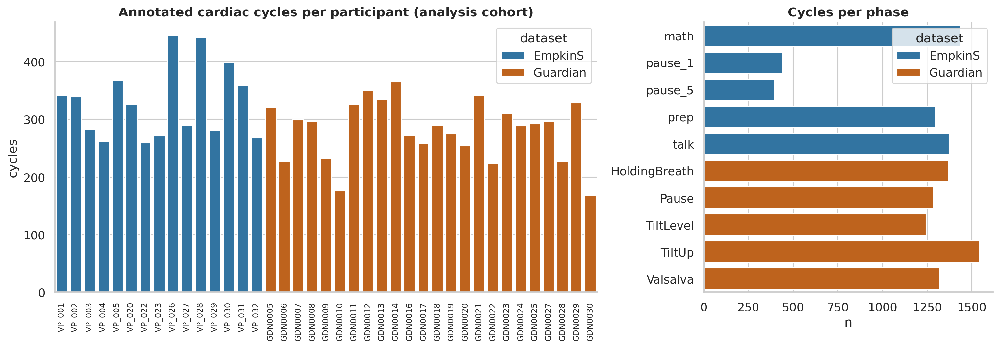

*Cycles per participant and per phase*

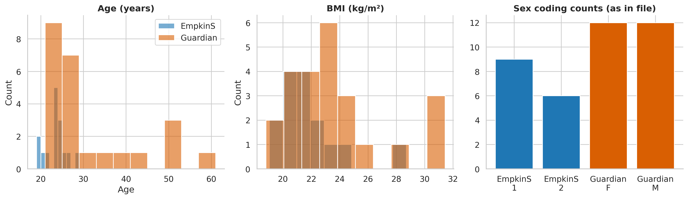

*Demographics*

## 2. Target (B-point) distribution

| Dataset | RB mean ± SD (ms) | min / max | PEP mean ± SD (ms) | skew | excess kurtosis |
|---|---|---|---|---|---|
| EmpkinS | 58.4 ± 23.3 | 4 / 194 | 88.6 ± 24.9 | 0.52 | 0.63 |
| Guardian | 106.4 ± 27.2 | -38 / 226 | 138.8 ± 26.9 | -0.41 | 0.58 |

Kolmogorov–Smirnov test of RB between datasets: D = 0.659, p = 0 (the two datasets have clearly different target ranges, the cause of cross-dataset error).

Share of RB variance explained by between-participant means: EmpkinS 0.35, Guardian 0.28.

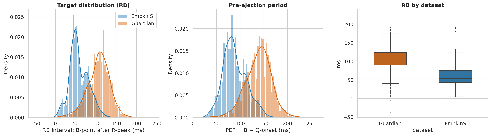

*Distribution of the RB interval and PEP*

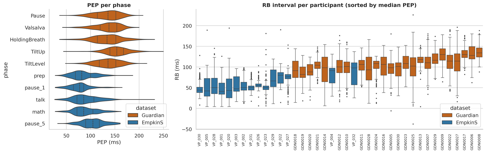

*B-point by phase and by participant*

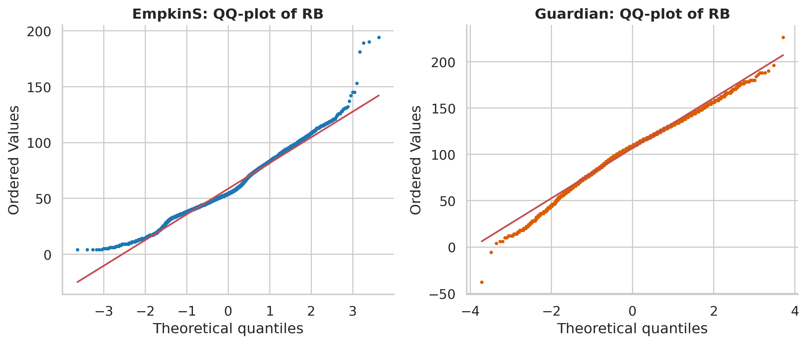

*QQ plots of RB*

## 3. Heart rate

Spearman ρ between HR and RB: EmpkinS -0.31, Guardian 0.20. HR-group counts: 60–100: 6922, >100: 2370, <60: 2128.

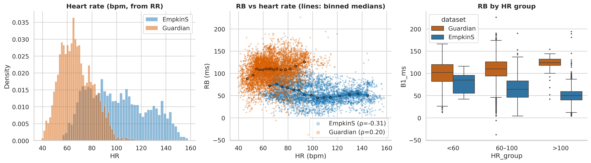

*Heart rate and its relation to RB*

## 4. Inter-rater agreement

n = 11,360 cycles with both raters. MAE 7.94 ms (SD of |diff| 14.26), median |diff| 2.0 ms, bias 4.18 ms, limits of agreement -26.8 to 35.1 ms, Pearson r = 0.904. (Abel et al. report 8.35 ± 14.78 ms.)

| Dataset | agreement level | % of cycles |
|---|---|---|
| EmpkinS | high ≤4 ms | 60.4 |
| EmpkinS | medium 4–10 ms | 21.7 |
| EmpkinS | low >10 ms | 17.9 |
| Guardian | high ≤4 ms | 73.0 |
| Guardian | medium 4–10 ms | 13.6 |
| Guardian | low >10 ms | 13.5 |

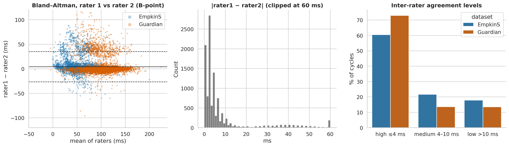

*Bland–Altman, histogram and agreement levels*

## 5. Waveform morphology

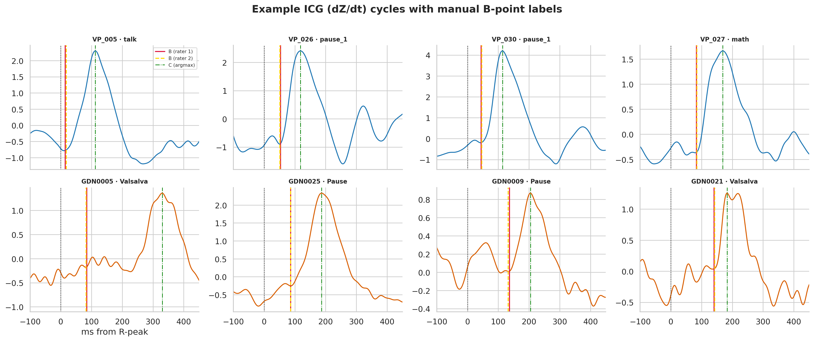

*Example cycles with both raters' B-points*

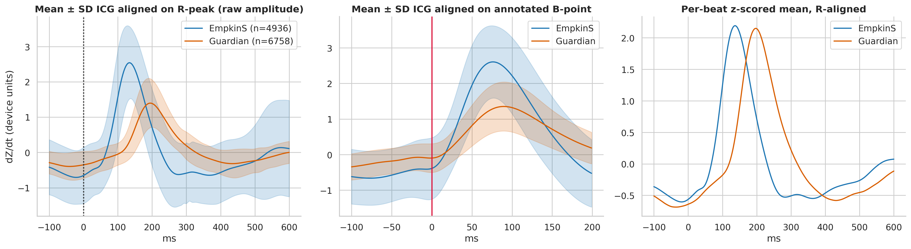

*Average waveforms aligned on R and on B*

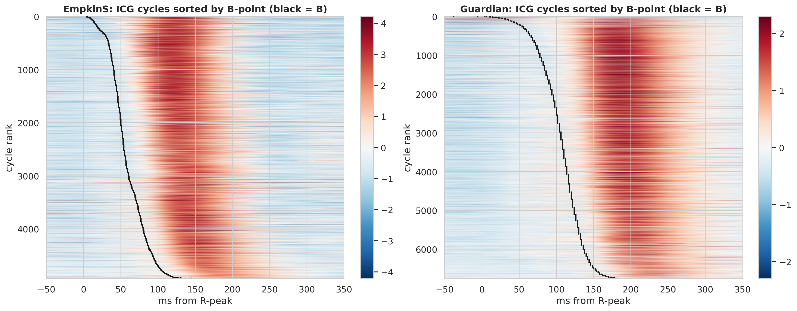

*All cycles sorted by B-point*

## 6. Relations between variables

Linear fit RB ~ RC: EmpkinS: slope 0.39, intercept 5.6, R² 0.24; Guardian: slope 0.17, intercept 72.1, R² 0.07.

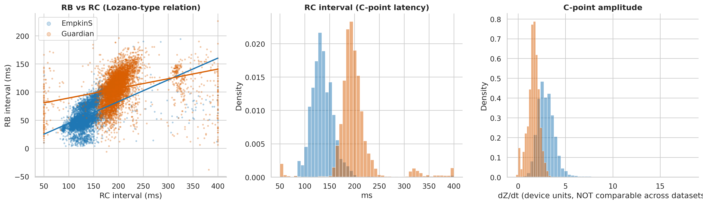

*RB vs RC and C-point statistics*

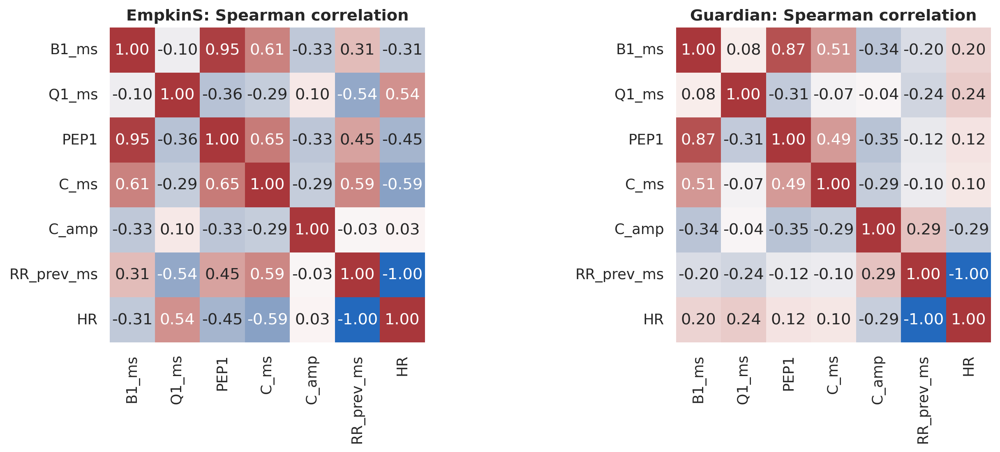

*Spearman correlations*

## 7. Signal quality and outliers

C-point amplitude (device units, not comparable between datasets): EmpkinS median 2.86; Guardian median 1.64.

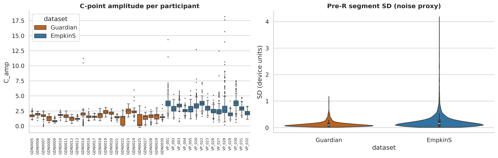

*Amplitude and noise proxy*

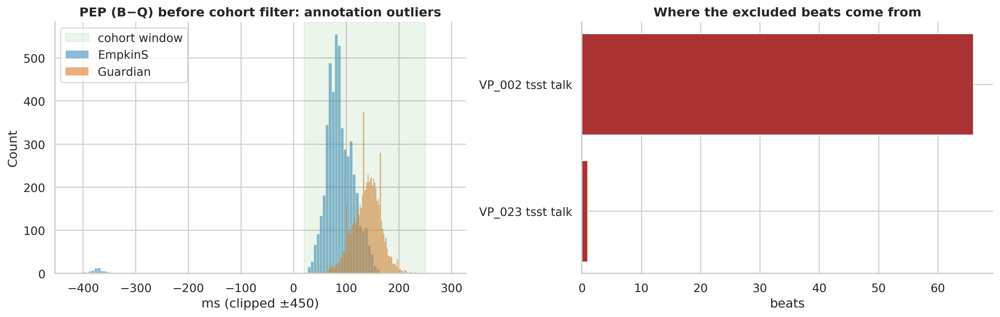

*Excluded annotation outliers*
